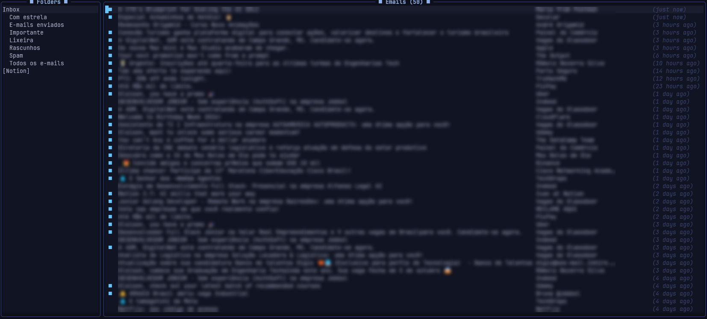

<h1 align="center">📫 Zenvoy</h1>

<p align="center">
  This Zenvoy is TUI for email.
</p>

<p align="center">
  
</p>

## About

A minimal email TUI for people who live in Neovim. Zenvoy is written entirely in
Lua and calls the Himalaya CLI asynchronously.

## Requirements

- [Neovim](https://neovim.io/doc/install/) >= v0.10.0
- [Himalaya](https://github.com/pimalaya/himalaya) >= v2.1.0, with a default account configured
- [nui.nvim](https://github.com/MunifTanjim/nui.nvim)

## Install

Install the plugin with your preferred plugin manager. For example, with [lazy.nvim](https://github.com/folke/lazy.nvim):

```lua
return {
    "Haavertz/zenvoy",
    dependencies = {
        "MunifTanjim/nui.nvim",
    },
    opts = {},
}
```

or Nvim >= 0.12.0

```lua
vim.pack.add({
    { src = "https://github.com/MunifTanjim/nui.nvim" },
    { src = "https://github.com/Haavertz/zenvoy" },
})

require("zenvoy").setup()
```

## Usage

Open the interface with `:Zenvoy`. Himalaya's configured default account and inbox
are used when it starts.

| Key | Action |
| --- | --- |
| `c` | Compose a new message |
| `r` / `R` | Reply / reply-all to the selected or opened email |
| `f` | Forward the selected or opened email with its attachments |
| `s` | Focus the mailbox sidebar |
| `j` / `k` in the sidebar | Select a mailbox and load its emails |
| `Enter` in the sidebar | Focus the email list; retry a failed mailbox load |
| `Enter` on an email | Read it below the list and mark it as seen |
| `q` | Return from the message pane, then close Zenvoy |
| `?` | Show all keybindings |

In the message pane:

| Key | Action |
| --- | --- |
| `z` | Show the email over the whole Zenvoy window, or below the list again |
| `Tab` / `Shift-Tab` | Jump to the next / previous link, image or attachment |
| `Enter` | Act on the item under the cursor: link, image or attachment menu; expand or collapse quoted text |
| `gx` | Open the link under the cursor |
| `S` | Save the attachment under the cursor (or choose one) |
| `I` | Render the image under the cursor |
| `T` | Switch between the formatted (HTML) and plain-text versions |

Confirmations and short menus open a small dialog in the middle of the screen.
`h` / `l`, the arrow keys or `Tab` move between its buttons, `Enter` chooses, and
`Escape` or `q` cancels. The safe choice, such as **Cancel** or **Keep
editing**, has the focus first, so `Enter` alone never sends or discards.

### Reading

An email opens below the list. Press `z` to show it over the whole Zenvoy
window, where the bottom border shows **Loading email** while it loads, and `z`
again to bring back the folders and the list. The next email opens below the
list again, and `q` returns to the list on the email that was open. In the
message pane `z` acts at once, so Vim's `z` commands (`zo`, `zz`) are not
available there.

Messages open with a header block (From, To, Cc, Reply-To when it differs,
Date and Subject) followed by the body. HTML email is laid out like webmail, as
plain text in the buffer: headings, bold and italic text, lists, quotes with a
bar, aligned data tables and underlined links. Layout tables are flattened,
and hidden preheaders, styles, scripts and tracking pixels are left out. A rule
across the pane separates the header from the body, and the body from the
attachments. Long quoted replies are folded; press `Enter` on one to read it,
and `Enter` on quoted text to fold it again.

Links are opened only on request. The bottom border shows the destination of
the link under the cursor, `Enter` shows it again with **Open link** and
**Copy link**, and `gx` opens it directly. Terminals with OSC 8 support can also
click the underlined text. Only `http`, `https` and `mailto` links are opened.

Attachments are listed at the end with their type and size. `Enter` on one
offers **Open**, **Save** and **Save to…**; `S` saves it right away to
`attachments.download_dir`, or to Himalaya's `downloads-dir` when unset. Open
uses a private temporary copy that Neovim removes on exit, and asks again
before opening file types that can run code. File names that hide their real
extension with direction-control characters are shown without them.

`T` shows the text/plain alternative instead. Set `reader.prefer = "plain"` to
make it the default.

### Images

In formatted emails, image markers such as `[Image: Logo]` appear where the image
is placed; in the plain-text view they are listed at the end of the body. Press
`I` (or `Enter`) on a marker to render it. Inline images are read from the
message; remote images ask before download. Rendering requires the optional
[image.nvim](https://github.com/3rd/image.nvim) plugin and a compatible terminal
backend (Kitty graphics, Sixel, or Überzug++). If rendering is unavailable, the
message text and image marker remain readable.

With lazy.nvim, install the renderer as an optional plugin and choose the backend
your terminal supports:

```lua
{
    "3rd/image.nvim",
    opts = {
        backend = "kitty",
        max_width_window_percentage = 80,
        max_height_window_percentage = 50,
    },
}
```

See [image.nvim's setup guide](https://github.com/3rd/image.nvim) for the
terminal and image-processing requirements for each backend. Remote images
also require `curl`.

### Composing

The composer covers the Zenvoy window like a webmail compose page: **To, Cc,
Bcc and Subject** on one labeled line each, the message below them, and the
attached **Files** at the bottom. Use `Tab` or `Shift-Tab` to move between the
fields in normal or insert mode; the label of the current one is highlighted.
Enter multiple recipients separated by commas. New messages start in To; replies
start above the editable quoted original in the message, after an
"On <date>, <sender> wrote:" line.

To attach files, press `Ctrl-a` in any field and choose a file with path
completion, or type, paste or complete (`Ctrl-x Ctrl-f`) one path per line in
Files. `~`, `$VARIABLES`, quoted paths and `file://` URLs are accepted.
Each line shows the file size, or why it cannot be attached. Delete a line to
remove the file. Attachments work the same way in new messages, replies and
forwards.

Forwarding (`f`) downloads the original attachments to a private temporary
directory and lists them in Files, so you can remove any of them before
sending. The original headers and text follow two empty lines left for your note.

Press `Ctrl-s`, then choose **Send** in the dialog; it states how many files
and how many bytes are attached, and the bottom border shows **Sending…** until
Himalaya finishes. Cancel keeps the draft open; a failed send also
keeps its text for a manual retry. `Escape` leaves insert mode normally. In
normal mode, `Escape` or `q` closes the composer and asks before discarding
changed text. A draft is held in memory only, and reopening the composer focuses
the existing draft.

Mailbox changes load the first page after a 150 ms pause, using the configured
page size (50 by default). Loading, downloading and sending activity appears at
the bottom of the sidebar. Replies preserve the email thread, prefer Reply-To,
and exclude your own address from reply-all. The configured Himalaya signature
is appended once when the final message is built. Messages with attachments get
a longer delivery timeout (5 minutes), so a slow upload is not reported as a
failure that invites a duplicate send.

The message body is plain text. Persistent drafts, account switching, and
automatically archiving a copy in Sent are not provided. An already-started send
continues if the interface is closed externally; its result is reported when the
process finishes. Reading an email with very large attachments is slower,
because Himalaya returns their decoded content with the message.

Attachments use `himalaya message compose --attach` and
`himalaya attachment download`, tested with Himalaya 2.2.

### Configuration

Default main-view shortcuts can be changed or disabled:

```lua
require("zenvoy").setup({
    himalaya = { page_size = 50 },
    reader = {
        prefer = "html",    -- or "plain" to open the text/plain version first
        max_width = 100,    -- wrap formatted email at this width; 0 uses the whole pane
        fold_quotes = true, -- collapse long quoted replies
    },
    attachments = {
        download_dir = "~/Downloads/mail", -- nil uses Himalaya's downloads-dir
    },
    keymaps = {
        ["s"] = false,
        ["gs"] = "focus_sidebar",
        ["c"] = "compose",
        ["r"] = "reply",
        ["R"] = "reply_all",
        ["f"] = "forward",
    },
})
```

Message-pane actions can be remapped the same way: `toggle_fullscreen` (`z`),
`open_link`, `save_attachment`, `show_image`, `toggle_view`, `next_item` and
`previous_item`; `help` (`?`) works in every pane. The `?` window lists the keys
as configured. The default highlight groups (`ZenvoyLink`, `ZenvoyQuote`,
`ZenvoyHeading`, `ZenvoyAttachment`, `ZenvoyLabel`, `ZenvoyMuted`,
`ZenvoyButton`, `ZenvoyButtonActive`, `ZenvoyKey` and others) link to standard
groups and can be overridden.
