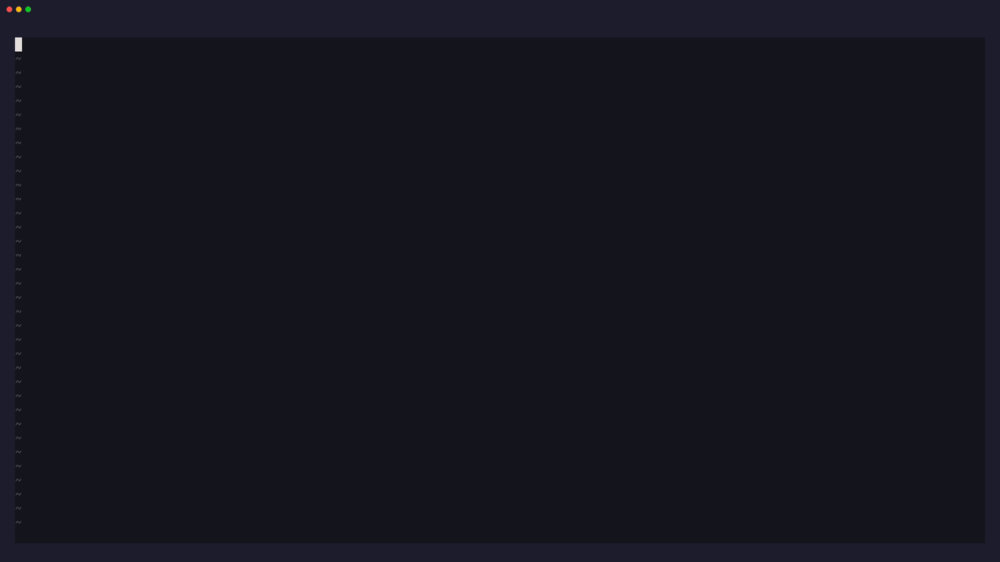

<h1 align="center">📫 Zenvoy</h1>

<p align="center">
  This Zenvoy is TUI for email.
</p>

<p align="center">
  
</p>

## About

A minimal email TUI for people who live in Neovim. Zenvoy is written entirely in
Lua and calls the Himalaya CLI asynchronously.

## Requirements

- [Neovim](https://neovim.io/doc/install/) >= v0.10.0
- [Himalaya](https://github.com/pimalaya/himalaya) >= v2.1.0, with a default account configured
- [nui.nvim](https://github.com/MunifTanjim/nui.nvim)

## Install

Install the plugin with your preferred plugin manager. For example, with [lazy.nvim](https://github.com/folke/lazy.nvim):

```lua
return {
    "Haavertz/zenvoy",
    dependencies = {
        "MunifTanjim/nui.nvim",
    },
    opts = {},
}
```

or Nvim >= 0.12.0

```lua
vim.pack.add({
    { src = "https://github.com/MunifTanjim/nui.nvim" },
    { src = "https://github.com/Haavertz/zenvoy" },
})

require("zenvoy").setup()
```

## Usage

Open the interface with `:Zenvoy`. Himalaya's configured default account and inbox
are used when it starts.

| Key | Action |
| --- | --- |
| `c` | Compose a new message |
| `r` / `R` | Reply / reply-all to the selected or opened email |
| `f` | Forward the selected or opened email with its attachments |
| `s` | Focus the mailbox sidebar |
| `j` / `k` in the sidebar | Select a mailbox and load its emails |
| `Enter` in the sidebar | Focus the email list; retry a failed mailbox load |
| `Enter` on an email | Read it below the list and mark it as seen |
| `n` / `N` in the email list | Show the next / previous page of emails |
| `q` | Return from the message pane, then close Zenvoy |
| `?` | Show all keybindings |

In the message pane:

| Key | Action |
| --- | --- |
| `z` | Show the email over the whole Zenvoy window, or below the list again |
| `Tab` / `Shift-Tab` | Jump to the next / previous link, image or attachment |
| `Enter` | Act on the item under the cursor: link, image or attachment menu; expand or collapse quoted text |
| `gx` | Open the link under the cursor |
| `S` | Save the attachment under the cursor (or choose one) |
| `I` | Render the image under the cursor |
| `T` | Switch between the formatted (HTML) and plain-text versions |

Confirmations and short menus open a small dialog in the middle of the screen.
`h` / `l`, the arrow keys or `Tab` move between its buttons, `Enter` chooses, and
`Escape` or `q` cancels. The safe choice, such as **Cancel** or **Keep
editing**, has the focus first, so `Enter` alone never sends or discards.

### Guides

- [Reading](docs/reading.md): the message pane, HTML email, links, quotes and attachments
- [Images](docs/images.md): showing images with image.nvim, and remote-image consent
- [Composing](docs/composing.md): writing, replying, forwarding and attaching files

### Configuration

Default main-view shortcuts can be changed or disabled:

```lua
require("zenvoy").setup({
    himalaya = { page_size = 40 },
    reader = {
        prefer = "html",    -- or "plain" to open the text/plain version first
        max_width = 100,    -- wrap formatted email at this width; 0 uses the whole pane
        fold_quotes = true, -- collapse long quoted replies
    },
    attachments = {
        download_dir = "~/Downloads/mail", -- nil uses Himalaya's downloads-dir
    },
    keymaps = {
        ["s"] = false,
        ["gs"] = "focus_sidebar",
        ["c"] = "compose",
        ["r"] = "reply",
        ["R"] = "reply_all",
        ["f"] = "forward",
    },
})
```

